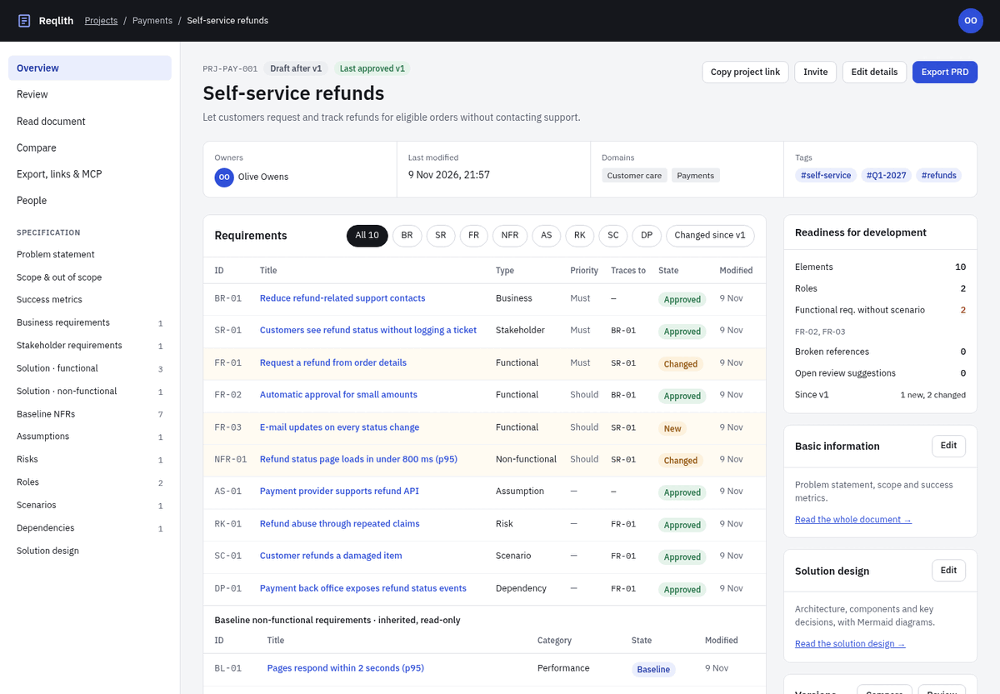
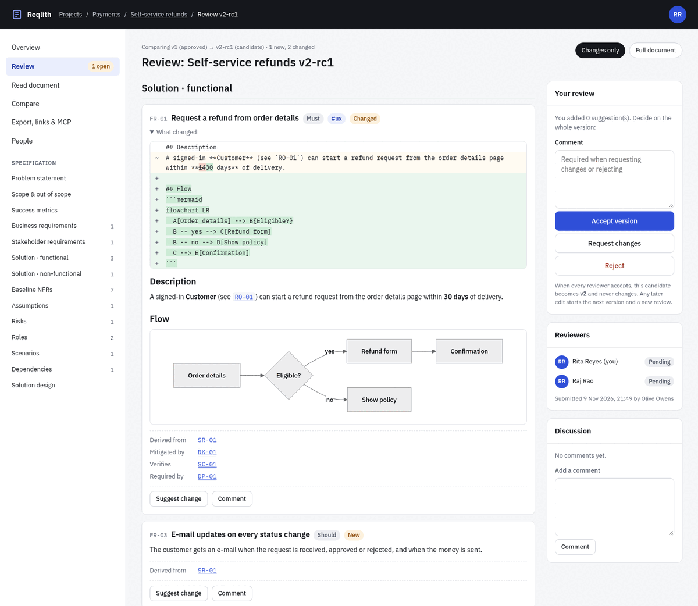
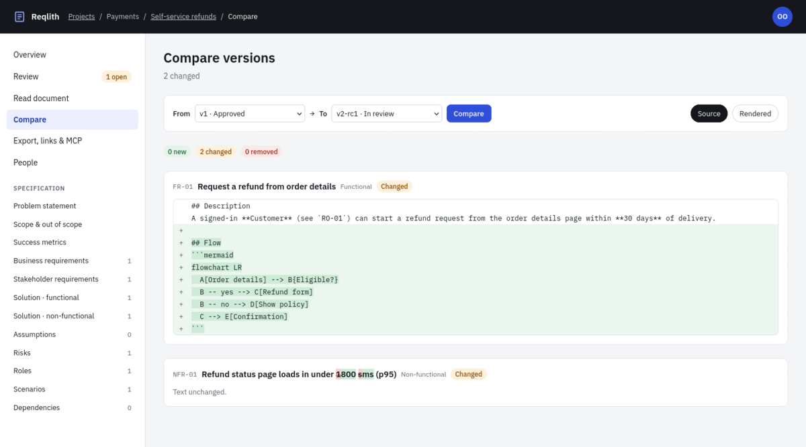
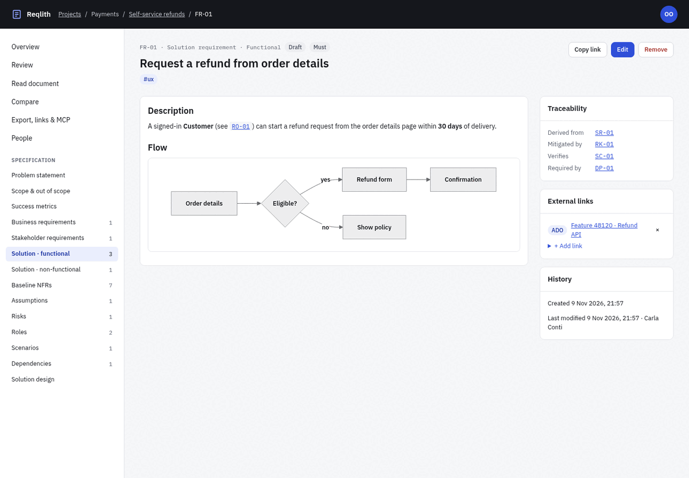
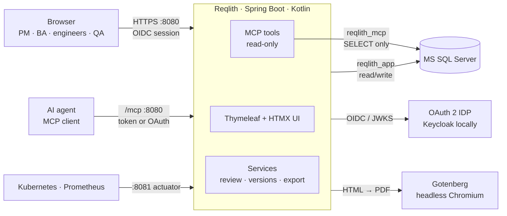
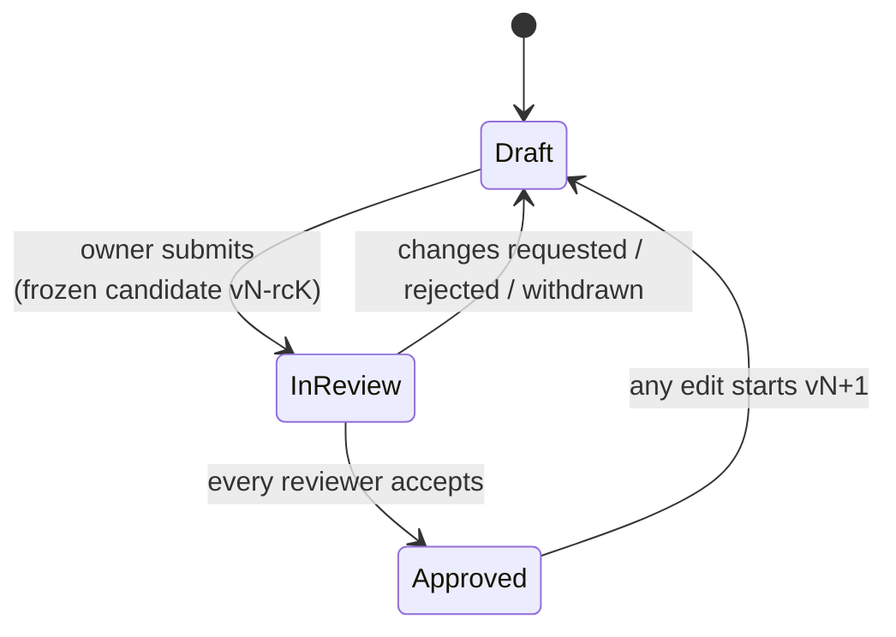

<div align="center">

# Reqlith

**Write requirements people can review, and agents can build from.**

Reqlith structures requirements along selected [BABOK®](#babok-alignment) concepts, reviews a project as a whole
and freezes every approved state as an immutable, numbered version. Product managers, analysts, engineers and QA work on one
specification; development agents read exactly the version that was approved, through a read-only MCP server.

[](https://github.com/msetkowski/reqlith/actions/workflows/ci.yml)
[](LICENSE)




</div>

## Why Reqlith

- **There are other tools for requirements management.** Established products cover formal requirements
  engineering well, with rich traceability, compliance workflows and integrations. Reqlith does not try to replace them.
- **Less formal, built for agentic development.** I wanted something lighter: a specification that a small team can
  write and approve quickly, and that coding agents can read as the source of truth when they build from it.
- **A custom tool on demand, built with AI agents.** Reqlith is also an experiment in whether a tailored tool
  can be built with AI coding agents when it is needed, instead of adapting a team's process to an off-the-shelf
  product.

## Contents

- [Why Reqlith](#why-reqlith)
- [Features](#features)
- [Screenshots](#screenshots)
- [Architecture](#architecture)
- [Quick start](#quick-start)
- [BABOK alignment](#babok-alignment)
- [How versions and reviews work](#how-versions-and-reviews-work)
- [MCP server for agents](#mcp-server-for-agents)
- [Development](#development)
- [Deployment and operations](#deployment-and-operations)
- [Configuration](#configuration)
- [Identity provider (Keycloak, Entra ID, other OIDC)](#identity-provider)
- [Contributing](#contributing)
- [License](#license)

## Features

- **Structured specification, following the BABOK requirements classification:** problem statement, scope and
  success metrics, plus business, stakeholder, functional and non-functional requirements, assumptions, risks,
  dependencies, scenarios and roles. See [BABOK alignment](#babok-alignment) for what is covered and what is not. Every element
  gets a permanent key (`BR-01`, `FR-12`, …) that is never reused.
- **Solution design:** one Markdown section per project for architecture, components and key decisions, with
  Mermaid diagrams. It is reviewed, versioned, compared and exported like the rest of the specification.
- **Markdown with Mermaid:** a two-pane editor with live preview. Diagrams are drawn in the browser and in
  PDFs. Writing `` `SR-03` `` links to that element.
- **Traceability:** typed links (derived from, verified by, depends on, mitigates) in both directions, plus
  readiness checks such as functional requirements without a scenario or broken references.
- **Invite by name:** while you type, invitation fields suggest people who signed in before, and optionally everyone
  allowed to use the app from the identity provider's directory (Keycloak or Microsoft Entra ID).
- **Roles across projects:** select an existing role or create one, then describe what it does in this
  project.
- **Non-functional requirements baseline:** global NFRs (`BL-01`, …) by category such as performance, availability,
  security or usability. Every project shows them as read-only items next to its own NFRs, and the PRD export
  includes them. They are not part of project versions, so changing the baseline never changes a project's state.
  Only users with the application role `ARCHITECT` maintain it (see [Identity provider](#identity-provider)).
- **Whole-project review:** reviewers accept, request changes or reject a frozen candidate, and can suggest
  wording on any element. Authors apply or dismiss suggestions afterwards.
- **Immutable versions:** approval turns the candidate into `v1`, `v2`, … A database trigger keeps approved
  versions from ever changing. Any two versions, or a version and the working copy, can be compared word by word.
- **Single-document PRD export:** Markdown or PDF, with traceability matrix and approval record. PDFs are
  printed by headless Chromium in a separate rendering service.
- **Links both ways:** paste `/p/{key}/v/{n}` into JIRA or ADO (it never changes), and attach JIRA, ADO or
  other links to the project, a version or a single element.
- **Read-only MCP server:** ten tools for agents, approved content by default, personal access tokens or
  OAuth, and an access log of every call.
- **Enterprise basics:** OAuth 2 / OIDC sign-in, MS SQL Server with Flyway, Kubernetes probes, Prometheus
  metrics and correlated logs. All JavaScript and fonts are bundled, with no CDN.

## Screenshots

| Review with "what changed" | Compare versions |
|---|---|
|  |  |

| Requirement with diagram, traceability and external links |
|---|
|  |

## Architecture



- **Server-side rendering:** Spring MVC with Thymeleaf and HTMX, plus two small JavaScript islands (editor
  toolbar and Mermaid). The same Markdown renderer serves the preview, the read views, the PDF and MCP.
- **Two kinds of data:** a mutable working copy, and immutable version snapshots stored as canonical JSON with
  a SHA-256 hash.
- **Stack:** Spring Boot 4.1, Kotlin 2.3 on Java 25, Spring Security, Spring AI MCP server, MS SQL Server,
  Flyway, Gotenberg and Keycloak (for local development).

## Quick start

**You need:** JDK 25, [mvnd](https://github.com/apache/maven-mvnd) or the bundled `./mvnw`, and Docker (with
compose) or Podman.

```bash
# 1. SQL Server, Keycloak (with test users) and the PDF renderer
docker compose -f src/main/dev/compose.yaml up -d      # or: src/main/dev/scripts/podman-dev.sh up

# 2. The application
mvnd spring-boot:run -Dspring-boot.run.profiles=local    # or: ./mvnw spring-boot:run -Dspring-boot.run.profiles=local
```

Open <http://localhost:8080> and sign in as `owner1` / `password`.

| Test user | Use it for |
|---|---|
| `owner1` | owner of the sample project |
| `owner2`, `contrib1` | second owner, contributor |
| `reviewer1`, `reviewer2` | reviewers |
| `viewer1` | read-only user |
| `architect1` | architect: maintains the NFR baseline |

All passwords are `password`. Local services:

| Service | Address | Credentials |
|---|---|---|
| Application | <http://localhost:8080> (actuator on `:8081`) | test users above |
| Keycloak | <http://localhost:8180> | admin console `admin` / `admin`, realm `reqlith` |
| MS SQL Server | `localhost:1433` | db `reqlith`, `reqlith_app` / `Reqlith_dev_app_1` |
| PDF renderer | <http://localhost:3000> | Gotenberg |

<details>
<summary>Run everything in containers / stop the environment</summary>

One command runs the tests, builds the image, starts the whole stack in a Podman pod and smoke-tests it
(sign-in through Keycloak, probes, metrics, MCP, PDF and Markdown export):

```bash
src/main/dev/scripts/podman-test.sh                 # options: --skip-tests, --fresh (empty database), --down
```

Or step by step:

```bash
./mvnw -DskipTests package                                         # the image is built from target/
docker compose -f src/main/dev/compose.yaml --profile full up -d --build
# or with Podman (builds the image itself):
src/main/dev/scripts/podman-dev.sh up --with-app

src/main/dev/scripts/podman-dev.sh down              # add --volumes to drop the database too
```

</details>

## BABOK alignment

Reqlith takes **selected elements** of the [BABOK® Guide](https://www.iiba.org/career-resources/a-business-analysis-professionals-foundation-for-success/babok/)
(International Institute of Business Analysis) as its structure. It covers the part of business analysis that turns
agreed needs into a reviewed, development-ready specification. It is not a complete BABOK implementation.

| BABOK concept | In Reqlith |
|---|---|
| Requirements classification schema: business, stakeholder and solution (functional, non-functional) requirements | element types `BR`, `SR`, `FR`, `NFR` |
| Business need and solution scope (Strategy Analysis outputs) | basic information: problem statement, scope and out of scope, success metrics |
| Assumptions, risks and dependencies | element types `AS`, `RK`, `DP`, each traceable like any requirement |
| Stakeholders | roles shared across projects, each described in the context of a project |
| Scenarios and use cases (technique) | element type `SC`, which verifies functional requirements |
| Trace Requirements | typed links (derived from, verified by, depends on, mitigates) in both directions, traceability matrix in the PRD |
| Prioritize Requirements | MoSCoW priority per element |
| Verify and Approve Requirements | whole-project review: reviewer decisions, suggestions, immutable approved versions |
| Maintain Requirements | versions, word-level comparison, reuse of roles across projects |

**Not covered:**
- transition requirements;
- elicitation and collaboration activities (interview notes, workshops);
- current and future state analysis;
- solution evaluation;
- a formal change request and impact analysis workflow;
- additional requirement attributes such as source, stability or complexity.

Constraints have no type of their own: capture them as non-functional requirements or in the scope.

BABOK® is a registered trademark of the International Institute of Business Analysis. Reqlith is not affiliated
with or endorsed by IIBA.

## How versions and reviews work



- **Submitting** freezes the working copy as a candidate (`v2-rc1`). Reviewers only ever see that frozen copy,
  and the working copy is read-only until the round closes.
- **Approval** happens when every assigned reviewer accepts. The candidate becomes `v2`, and version numbers
  have no gaps. One "request changes" or "reject" closes the round.
- **Approved versions never change.** The application refuses it, and so does a database trigger. Role
  descriptions are copied into the snapshot, so editing a shared role later does not rewrite history.
- **Stable links:** `/p/{key}` is always the latest approved version, and `/p/{key}/v/{n}` never changes. Use
  the second one in JIRA or ADO.

## MCP server for agents

`/mcp` is a read-only [Model Context Protocol](https://modelcontextprotocol.io) server (streamable HTTP) for
agents that assess requirements, suggest improvements or build a backlog with their own tools.

| Tool | Returns |
|---|---|
| `list_projects` | projects, owners, state, tags, domains |
| `get_prd` | the whole specification as one Markdown PRD, including the NFR baseline |
| `search_requirements` | elements by type, tag or text, plus matching baseline NFRs (project `baseline`) |
| `get_requirement` | one element with traceability and external links; `BL-` keys work with any project |
| `get_traceability` | BR → SR → FR/NFR → scenario graph, with its gaps |
| `list_versions`, `diff_versions` | version history and unified diffs |
| `get_review_status` | reviewers, decisions, open suggestions |
| `get_external_links`, `list_roles` | JIRA / ADO references, shared roles |
| `list_baseline_requirements` | the NFR baseline, optionally by category or text |

- **Approved by default:** tools return the latest approved version unless `version` is `"2"`, `"3-rc1"` or
  `"draft"`, so agents never build on unreviewed work by accident.
- **Authentication:** a personal access token (`rql_…`, created under *Account → Access tokens for agents* and
  stored hashed), or an OAuth 2.1 token from the IDP. Unauthenticated calls get `401` with a pointer to
  `/.well-known/oauth-protected-resource` (RFC 9728). The local realm has a public client `reqlith-mcp`
  (authorization code with PKCE, and device flow).
- **Read-only by construction:** tools read through their own connection pool, logged in as a database user with
  `db_datareader` only.
- **Access log:** every call is recorded with client, user, token and tool, and shown on the project page and
  on the token page.

```json
{
  "mcpServers": {
    "reqlith": {
      "type": "http",
      "url": "http://localhost:8080/mcp",
      "headers": { "Authorization": "Bearer rql_…" }
    }
  }
}
```

## Development

### Tests and coverage

```bash
src/main/dev/scripts/test.sh                 # mvnd verify, with container setup and cleanup
src/main/dev/scripts/test.sh clean verify    # any Maven arguments
```

| Plugin | Runs | Phase |
|---|---|---|
| Surefire | unit tests `*Test` (no Spring context, no containers) | `test` |
| Failsafe | integration tests `*IT` (Spring context, SQL Server and the PDF renderer via Testcontainers, MCP over HTTP) | `integration-test` / `verify` |

JaCoCo measures both runs and merges them. Reports go to `target/site/jacoco-unit`, `target/site/jacoco-it`
and `target/site/jacoco` (merged). Skip measurement with `-Djacoco.skip=true`.

<details>
<summary>What <code>test.sh</code> does for Testcontainers (Podman friendly)</summary>

- With Podman, it starts the user API socket if needed and sets `DOCKER_HOST`. It also configures the Ryuk
  reaper for rootless Podman (`TESTCONTAINERS_DOCKER_SOCKET_OVERRIDE`,
  `TESTCONTAINERS_RYUK_CONTAINER_PRIVILEGED`), so containers are removed even when the test JVM crashes.
- On exit, including Ctrl+C, it removes any container still labelled `io.reqlith.test`.
- Failsafe kills a test JVM that hangs for more than 20 minutes.
- All tests in a run share one SQL Server and one renderer container.

Running `mvnd verify` directly also works when Docker is available, or when those variables are exported.

</details>

### Project layout

```
src/main/kotlin/io/reqlith
├── config        Spring configuration: security (web UI and /mcp), properties, MCP read-only database, logging
├── controller    MVC controllers, MCP tools, view helpers
├── service       business logic: projects, elements, roles, reviews, versions, snapshots, diff, export, markdown
├── repository    Spring Data repositories and JDBC access (key counter, export cache, MCP read model, access log)
├── model
│   ├── entity    JPA entities and their enums
│   └── dto       snapshot documents, forms, view models, MCP results, principals
└── exception     business exceptions and error handling
src/main/resources   templates, static assets (vendored JS and fonts), Flyway migrations, configuration
src/main/docker      Dockerfile (Alpine + JRE 25)
src/main/dev         compose.yaml, Keycloak realm, database init, scripts (podman-dev, podman-test, test, build-image, update-vendor)
```

Tests mirror the package layout. Shared test setup lives in `support`.

### Logging conventions

The project uses [kotlin-logging](https://github.com/oshai/kotlin-logging): one logger per file, with messages
as lambdas.

```kotlin
private val logger = KotlinLogging.logger {}

logger.info { "Version approved project=${project.key} version=${version.label}" }
logger.error(e) { "PDF export failed: ${e.message}" }
```

| Level | Use for |
|---|---|
| `INFO` | business actions and security events: sign-in, changes, invitations, review lifecycle, approvals, exports, MCP calls, access tokens, access denied |
| `DEBUG` | engineer hints: allocated keys, snapshot hashes, stale forms, PDF cache and renderer timings, MCP authentication |
| `ERROR` | failures: unexpected exceptions (with an error id shown to the user), renderer failures, failing MCP tools |

- **Correlation:** every line carries `[requestId userId]`. The request id is taken from `X-Request-Id` (or
  generated) and returned in the response.
- **Personal data:** logs contain ids only, no e-mail addresses, tokens or document content.

## Deployment and operations

### Container image

The image has no builder stage. Maven builds everything into `target/`, and the Dockerfile copies the result
onto Alpine with the JRE installed from Alpine's packages. The image build fails if that JRE is not Java 25.

```bash
src/main/dev/scripts/build-image.sh     # mvnd -DskipTests package && docker/podman build -f src/main/docker/Dockerfile .
```

| Layer | Source | Changes |
|---|---|---|
| Alpine + JRE 25 | `apk add openjdk25-jre-headless` | rarely |
| `/opt/reqlith/lib` | runtime dependencies (`target/docker/lib`) | when dependencies change |
| `/opt/reqlith/classes` | compiled code, templates, assets, migrations (`target/classes`) | every change, about 5 MB |

The image is about 350 MB. Building requires JDK 25 or newer, which the Maven enforcer plugin checks.

### Services to run

| Service | Notes |
|---|---|
| Reqlith | ports 8080 (application) and 8081 (actuator, cluster-internal) |
| MS SQL Server | case-insensitive collation (the default, e.g. `SQL_Latin1_General_CP1_CI_AS`); schema owned by `reqlith_app`. Create a `reqlith_mcp` login with read rights for MCP (see `src/main/dev/mssql/init.sql`). |
| OAuth 2 / OIDC IDP | Keycloak, Microsoft Entra ID or any OIDC provider. See [Identity provider](#identity-provider). |
| Gotenberg | PDF rendering. Keep it internal, and start it with `--chromium-allow-list=^file:///tmp/.*` so rendered pages have no network access. |

### Health and metrics

Actuator runs on a separate **management port, 8081**. Its endpoints are open there for probes and scraping,
and the application port does not serve `/actuator` at all.

| Endpoint | Purpose |
|---|---|
| `/actuator/health/liveness` | liveness probe (does not depend on the database) |
| `/actuator/health/readiness` | readiness probe (includes the database) |
| `/actuator/prometheus` | Prometheus metrics (JVM, HTTP with histograms, connection pools), tagged `application="reqlith"` |

```yaml
livenessProbe:
  httpGet: { path: /actuator/health/liveness, port: 8081 }
  initialDelaySeconds: 30
readinessProbe:
  httpGet: { path: /actuator/health/readiness, port: 8081 }
# Pod annotations for annotation-based Prometheus scraping
prometheus.io/scrape: "true"
prometheus.io/path: /actuator/prometheus
prometheus.io/port: "8081"
```

PDFs of closed versions are cached in the database, so only the first export of a version needs the
renderer.

## Configuration

Environment-specific settings and secrets have **no defaults**. If any is missing, the application refuses to
start and lists all missing variables at once. The `local` profile (`SPRING_PROFILES_ACTIVE=local`, used by
the commands above and by the dev containers) provides values for the local environment. Each of them can
still be overridden with the variable.

| Variable | Required | `local` profile value | Purpose |
|---|---|---|---|
| `REQLITH_DB_URL` | yes | `jdbc:sqlserver://localhost:1433;databaseName=reqlith;…` | main datasource |
| `REQLITH_DB_PASSWORD` | yes | dev password | main datasource (schema owner, Flyway) |
| `REQLITH_MCP_DB_PASSWORD` | yes | dev password | read-only connection for the MCP server |
| `REQLITH_IDP_CLIENT_SECRET` | yes | `reqlith-dev-secret` | OIDC client secret |
| `REQLITH_IDP_ISSUER` | yes | `http://localhost:8180/realms/reqlith` | token issuer (`iss`), see [Identity provider](#identity-provider) |
| `REQLITH_BASE_URL` | yes | `http://localhost:8080` | public URL for copyable links and the MCP configuration |
| `REQLITH_PDF_URL` | yes | `http://localhost:3000` | PDF rendering service (Gotenberg) |
| `REQLITH_DB_USER` / `REQLITH_MCP_DB_USER` | no | `reqlith_app` / `reqlith_mcp` | database users |
| `REQLITH_MCP_DB_URL` | no | main URL | read-only connection, if it differs |
| `REQLITH_IDP_TYPE` | no | `KEYCLOAK` | `KEYCLOAK`, `ENTRA` or `GENERIC`: how endpoints are derived from the issuer |
| `REQLITH_IDP_CLIENT_ID` | no | `reqlith-app` | OIDC client (Entra: application/client id) |
| `REQLITH_IDP_INTERNAL_URL` | no | the issuer | Keycloak: how the server reaches the IDP, when that differs (containers) |
| `REQLITH_IDP_AUTHORIZATION_URI`, `_TOKEN_URI`, `_JWKS_URI`, `_USER_INFO_URI`, `_END_SESSION_URI` | `GENERIC` only (first three) | derived from the type | endpoint overrides |
| `REQLITH_IDP_MCP_AUDIENCE` | no | not checked | required `aud` of IDP access tokens at `/mcp` (Entra: the API's application ID URI) |
| `REQLITH_IDP_DIRECTORY` | no | `KEYCLOAK` (`NONE` otherwise) | invitation suggestions: `NONE`, `KEYCLOAK`, `ENTRA` or `ENTRA_ASSIGNED` |
| `REQLITH_IDP_ROLES_CLAIM` | no | `roles` | token claim with the user's IDP roles; dotted names reach nested claims (`realm_access.roles`) |
| `REQLITH_IDP_ARCHITECT_ROLES` | no | `ARCHITECT` | IDP roles (comma-separated, case-insensitive) that grant the application role `ARCHITECT` |
| `MANAGEMENT_PORT` | no | `8081` | actuator port |
| `LOGGING_LEVEL_IO_REQLITH` | no | `DEBUG` (`INFO` otherwise) | application log level |

The IDP endpoints are configured explicitly rather than discovered, so the app starts even when the IDP is down.
ID token issuers are still validated against `REQLITH_IDP_ISSUER`.

## Identity provider

Reqlith signs users in with OpenID Connect (authorization code with a client secret), and the endpoints are
configured, not discovered: the app starts even while the IDP is down. `REQLITH_IDP_TYPE` derives the endpoints
from the issuer. Every endpoint can be overridden with `REQLITH_IDP_*_URI`.

| | Keycloak (`KEYCLOAK`, default) | Microsoft Entra ID (`ENTRA`) | Other OIDC (`GENERIC`) |
|---|---|---|---|
| Issuer | `https://host/realms/<realm>` | `https://login.microsoftonline.com/<tenant-id>/v2.0` | as in its tokens |
| Endpoints | `…/protocol/openid-connect/{auth,token,certs,userinfo,logout}` | `…/oauth2/v2.0/{authorize,token,logout}`, `…/discovery/v2.0/keys`; claims from the ID token | set authorization, token and JWKS URIs |
| User directory | `KEYCLOAK` | `ENTRA` or `ENTRA_ASSIGNED` | `NONE` |

User e-mail addresses (used to match invitations) come from the `email` claim. When that claim is missing, as it
often is with Entra, they come from `preferred_username` or `upn` if those are addresses.

**Application roles** come from the claim `REQLITH_IDP_ROLES_CLAIM` (default `roles`) at sign-in. A user holding
one of `REQLITH_IDP_ARCHITECT_ROLES` becomes an `ARCHITECT` and may maintain the NFR baseline. Project roles
(owner, contributor, reviewer) are managed in Reqlith itself. A changed role takes effect at the next sign-in.

**Invitation suggestions** always include users who have signed in before. With a directory, everyone allowed to use
the app can be suggested, which also shows those names and addresses to every signed-in user.

<details>
<summary>Keycloak setup</summary>

- **Client:** confidential OIDC client with redirect URI `https://<reqlith>/login/oauth2/code/idp` (see
  `src/main/dev/keycloak/reqlith-realm.json`).
- **Directory (`REQLITH_IDP_DIRECTORY=KEYCLOAK`):** enable the client's service account and give it the
  `realm-management` role `view-users`. Add the client scope `kc-admin-api` as an **optional** scope; Keycloak's
  admin API (26.4+) requires it, and Reqlith requests it only for directory calls. Suggestions list the realm's
  enabled users.
- **MCP over OAuth:** a public client for MCP clients (the local realm has `reqlith-mcp`).
- **Architects:** create the realm role `ARCHITECT` and assign it. Add a *User Realm Role* mapper to the client
  with token claim name `roles`, multivalued, added to the ID token (the local realm does this, and `architect1`
  has the role). To use Keycloak's built-in `realm_access.roles` instead, switch on *Add to ID token* for the
  *realm roles* mapper of the `roles` client scope and set `REQLITH_IDP_ROLES_CLAIM=realm_access.roles`.

</details>

<details>
<summary>Microsoft Entra ID setup</summary>

1. **App registration** (single tenant). Add the web redirect URI `https://<reqlith>/login/oauth2/code/idp`
   and the front-channel logout / post-logout redirect `https://<reqlith>/`. Create a client secret.
2. **Token configuration:** add the optional claim `email` to the ID token. Without it, Reqlith uses
   `preferred_username`.
3. **Who may sign in:** in the enterprise application, set *Assignment required* to *Yes* and assign users or
   groups. Otherwise every user in the tenant can sign in.
4. **Directory for suggestions**, under *API permissions → Application permissions → Microsoft Graph*, then grant
   admin consent:
   - `REQLITH_IDP_DIRECTORY=ENTRA`: `User.Read.All`. Suggests enabled users of the tenant.
   - `REQLITH_IDP_DIRECTORY=ENTRA_ASSIGNED`: additionally `Application.Read.All`. Suggests only users assigned
     directly to the enterprise application (group assignments are not expanded; matching is by display name).
5. **MCP with Entra tokens (optional):** under *Expose an API*, set an application ID URI (e.g.
   `api://reqlith`) and a scope. In the manifest, set `requestedAccessTokenVersion` (or `accessTokenAcceptedVersion`)
   to `2` so access tokens carry the v2 issuer. Set `REQLITH_IDP_MCP_AUDIENCE` to the audience of those tokens
   (usually the application ID URI or client id). Personal access tokens work regardless.
6. **Architects (optional):** under *App roles*, create a role with value `ARCHITECT` for users/groups and assign
   it in the enterprise application. Entra puts assigned app roles in the ID token's `roles` claim. If your role
   has another value, set `REQLITH_IDP_ARCHITECT_ROLES` to it.

```bash
REQLITH_IDP_TYPE=ENTRA
REQLITH_IDP_ISSUER=https://login.microsoftonline.com/<tenant-id>/v2.0
REQLITH_IDP_CLIENT_ID=<application (client) id>
REQLITH_IDP_CLIENT_SECRET=<client secret>
REQLITH_IDP_DIRECTORY=ENTRA_ASSIGNED        # or ENTRA, or NONE
REQLITH_IDP_MCP_AUDIENCE=api://reqlith      # optional
```

</details>

<details>
<summary>Other OIDC providers</summary>

```bash
REQLITH_IDP_TYPE=GENERIC
REQLITH_IDP_ISSUER=https://idp.example.com
REQLITH_IDP_AUTHORIZATION_URI=https://idp.example.com/authorize
REQLITH_IDP_TOKEN_URI=https://idp.example.com/token
REQLITH_IDP_JWKS_URI=https://idp.example.com/jwks
REQLITH_IDP_USER_INFO_URI=…        # optional; without it, claims come from the ID token
REQLITH_IDP_END_SESSION_URI=…      # optional; without it, sign-out ends only the Reqlith session
```

The values are listed under `authorization_endpoint`, `token_endpoint`, `jwks_uri`, `userinfo_endpoint` and
`end_session_endpoint` in the provider's `/.well-known/openid-configuration`.

</details>

## Contributing

1. Run `src/main/dev/scripts/test.sh` (or `podman-test.sh` for the full stack) before you open a pull request.
2. Code is formatted by [ktlint](https://pinterest.github.io/ktlint/) on every build (rules in `.editorconfig`, IntelliJ
   IDEA style, 160 columns). `verify` fails on what it cannot fix, such as overlong lines.
3. Keep to the package layout (controllers stay thin, logic lives in services, data access in
   repositories) and to the logging conventions above.
4. Schema changes go into a new Flyway migration in `src/main/resources/db/migration`. Never edit an applied
   one.
5. To upgrade the bundled front-end libraries, change the versions in `src/main/dev/scripts/update-vendor.sh`
   and run it.

## License

[Apache License 2.0](LICENSE). Bundled third-party files (htmx, Mermaid, IBM Plex fonts) keep their own licenses.
See [THIRD-PARTY-NOTICES.md](THIRD-PARTY-NOTICES.md).
